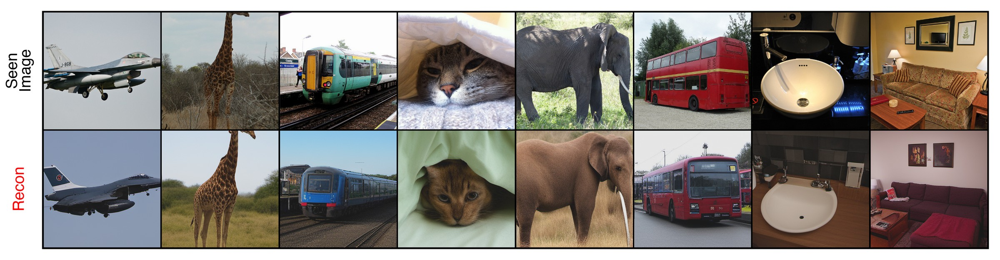

<h1 align="center">CortexDecoder: fMRI-to-Image Reconstruction from Cortical Flatmaps</h1>

<p align="center">
  <a href="https://www.biorxiv.org/content/10.64898/2026.10.09.757766v1"></a>
  <a href="https://huggingface.co/teooi/cortexdecoder"></a>
  <a href="https://huggingface.co/datasets/teooi/cortexdecoder-nsd-flatmaps"></a>
  <a href="https://opensource.org/licenses/MIT"></a>
</p>

Reconstructs viewed images from fMRI using cortical flatmaps. A frozen CortexMAE encoder turns visual-cortex flatmap patches into brain tokens, two cross-attention bridges predict VGG (low-level) and OpenCLIP bigG (semantic) features, and a frozen SDXL-unCLIP model generates the image from a Deep Image Prior init. Only the bridges are trained (83M parameters, about 3 H100-hours).

<p align="center">
  
</p>

## Results

NSD Subject 1, 998 test images, one sample per image. NeuroPictor is the other cortical-flatmap method. Its frozen-encoder ablation uses the same setting as ours (Subject 1 only, frozen fMRI encoder), and bold marks the better result of that pair. The last row is the full NeuroPictor model, for reference.

| Method | PixCorr↑ | SSIM↑ | Alex(2)↑ | Alex(5)↑ | Incep↑ | CLIP↑ | Eff↓ | SwAV↓ |
|---|---|---|---|---|---|---|---|---|
| NeuroPictor, frozen encoder | 0.220 | 0.342 | 97.5% | 98.8% | 93.8% | 92.8% | 0.657 | 0.360 |
| **CortexDecoder** | **0.366** | **0.413** | **98.1%** | **99.1%** | **94.9%** | **93.5%** | **0.628** | 0.360 |
| *NeuroPictor, multi-subject + fine-tuned encoder* | *0.277* | *0.385* | *98.8%* | *99.3%* | *96.2%* | *94.5%* | *0.619* | *0.334* |

Table 1 of the paper compares CortexDecoder with voxel-based methods.

## Reproduce

Everything runs on [Modal](https://modal.com) with the `braid2-flatmap-data` volume. Runs start detached, so they keep going if your laptop closes. Use the same run name in all four steps.

```bash
modal deploy code/v2/modal_app.py

# 1. Low-level bridge and DIP images
python3 code/v2/scripts/spawn_runs.py vgg '{"timestamp": "RUN", "brain_tokens": "flatmap_tokens_roi-nsdgeneral_fp16"}'

# 2. Semantic bridge, trained with MSE
python3 code/v2/scripts/spawn_runs.py clip '{"timestamp": "RUN", "brain_tokens": "flatmap_tokens_roi-nsdgeneral_fp16"}'

# 3. Decoder-aware fine-tune of the semantic bridge (CLIP_DIR is the output directory step 2 prints)
python3 code/v2/scripts/spawn_runs.py clip '{"timestamp": "RUN", "brain_tokens": "flatmap_tokens_roi-nsdgeneral_fp16", "decoder_loss_weight": 16.0, "lr": 5e-5, "epochs": 5, "warmup_epochs": 0, "init_checkpoint": "CLIP_DIR/clip_best.pt"}'

# 4. Final images and metrics
python3 code/v2/scripts/spawn_runs.py final '{"timestamp": "RUN", "brain_tokens": "flatmap_tokens_roi-nsdgeneral_fp16", "vgg_brain_tokens": "flatmap_tokens_roi-nsdgeneral_fp16", "decoder_loss_weight": 16.0}'
```

The visual-cortex tokens (`flatmap_tokens_roi-nsdgeneral_fp16`) come from `scripts/generate_roi_tokens.py`. Any field in [`config.py`](code/v2/cortexdecoder/core/config.py) can go in the JSON, and [`pipeline.py`](code/v2/cortexdecoder/pipeline.py) lists what each stage runs.

## Code

```
code/v2/
  cortexdecoder/   Python package (data, bridge model, training, DIP and diffusion, metrics)
  modal_app.py     Modal functions for each stage
  scripts/         run launcher, visual-cortex ROI tokens, paper figures, Hugging Face release
```

The code and model weights are MIT-licensed. The flatmap dataset follows the [NSD terms of use](https://cvnlab.slite.page/p/IB6BSeW_7o/Terms-and-Conditions).

## Citation

```bibtex
@article{imototar2026cortexdecoder,
  title   = {CortexDecoder: fMRI-to-image Reconstruction from Cortical Flatmaps},
  author  = {Imoto-Tar, Teo and Fung, Maxwell and Gurha, Arnav},
  journal = {bioRxiv},
  year    = {2026},
  doi     = {10.64898/2026.10.09.757766}
}
```
