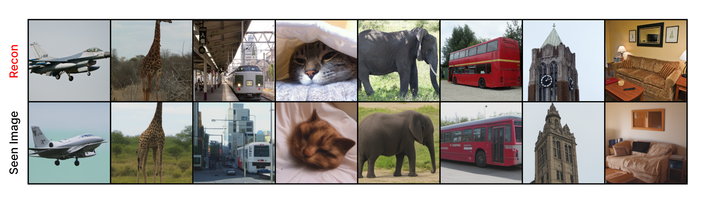

# CortexDecoder: fMRI-to-Image Reconstruction from Cortical Flatmaps

Reconstructs viewed images from fMRI using cortical flatmaps. A frozen CortexMAE encoder turns flatmap patches into brain tokens, two cross-attention bridges predict VGG (low-level) and OpenCLIP bigG (semantic) features, and a frozen SDXL-unCLIP model generates the image from a Deep Image Prior init. Only the bridges are trained (~83M params).

**Paper:** [bioRxiv preprint](https://www.biorxiv.org/content/10.64898/2026.10.09.757766v1)



## Usage

Runs on [Modal](https://modal.com) with the `braid2-flatmap-data` volume.

```bash
modal deploy code/v2/modal_app.py
python3 code/v2/scripts/spawn_runs.py clip  '{"timestamp": "<run-id>"}'
python3 code/v2/scripts/spawn_runs.py vgg   '{"timestamp": "<run-id>"}'
python3 code/v2/scripts/spawn_runs.py final '{"timestamp": "<run-id>", "final_eval_images": 1000}'
```

Config knobs live in `code/v2/cortexdecoder/core/config.py`; any field can be passed as an override.

## Layout

```
code/v2/   pipeline (Python package + Modal app)
code/v1/   original notebooks
papers/    AAAI workshop paper (AAAI_workshop_paper/), earlier IEEE draft (wacv_paper/)
results/   evaluation tables
```

## Citation

```bibtex
@article{imototar2026cortexdecoder,
  title   = {CortexDecoder: fMRI-to-image Reconstruction from Cortical Flatmaps},
  author  = {Imoto-Tar, Teo and Fung, Maxwell and Gurha, Arnav},
  journal = {bioRxiv},
  year    = {2026},
  doi     = {10.64898/2026.10.09.757766}
}
```
